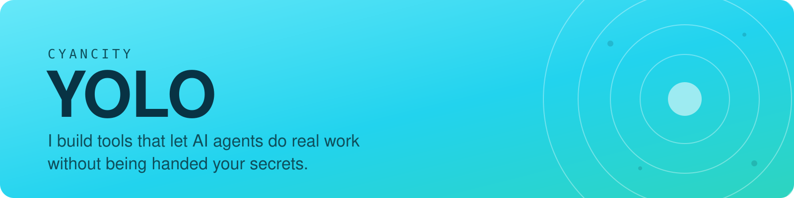
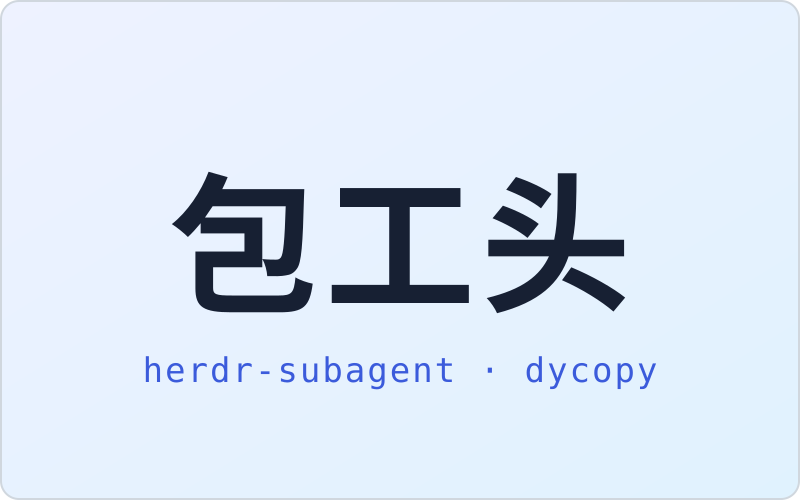
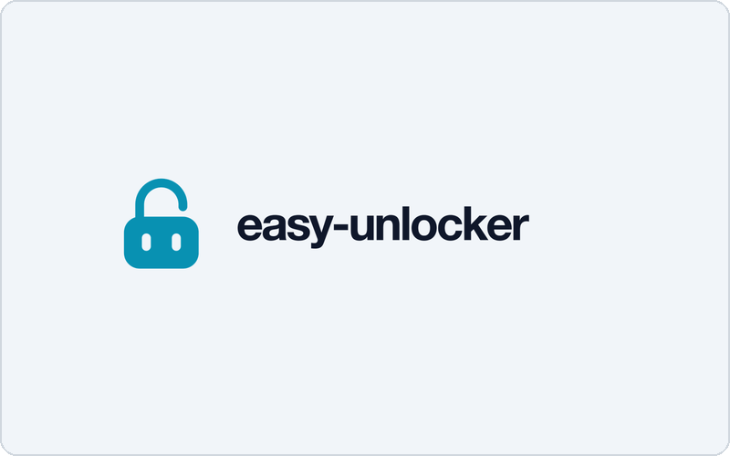
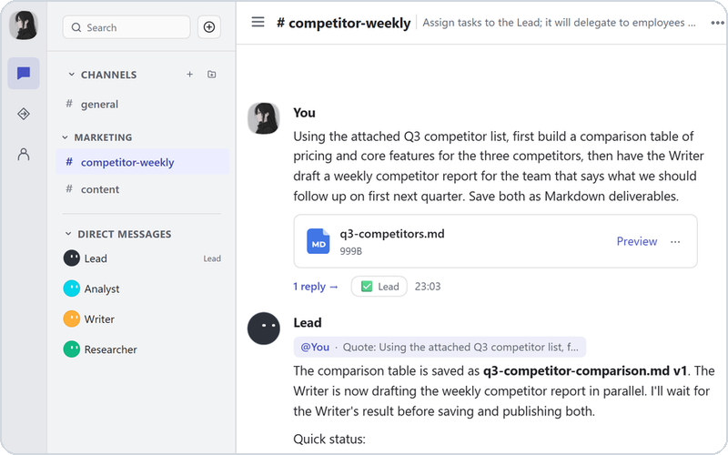
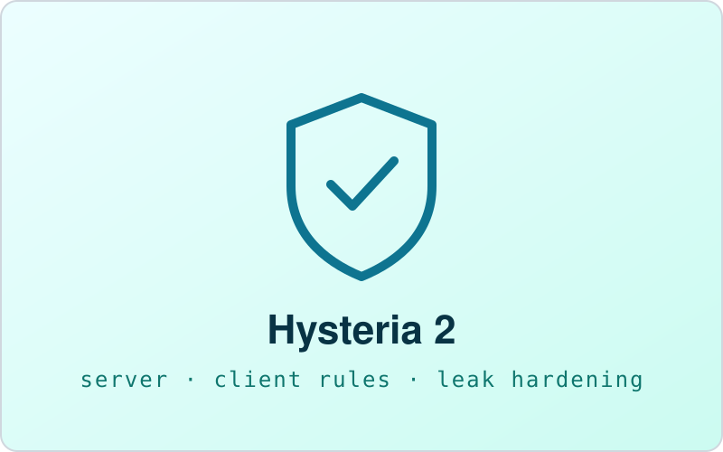

<picture>
  <source media="(prefers-color-scheme: dark)" srcset="assets/banner-dark.svg">
  
</picture>

<table>
  <tr>
    <td width="25%" valign="top">
      <picture>
        <source media="(prefers-color-scheme: dark)" srcset="assets/package-dark.svg">
        
      </picture>
      <a href="https://github.com/cyancity/curated-agent-skills"><b>curated-agent-skills</b></a> 
      <b>主推</b> · 找包工头点这里 
      两枚 skill，审阅脱敏后公开。 
      ✅ 包工头派活并验收 ⚠️ 2 个 skill，先装 Herdr 
      <b>适合</b> 跨 CLI 派活、长任务 <b>不适合</b> 单文件小改 
      → <a href="https://github.com/cyancity/curated-agent-skills/tree/main/skills/herdr-subagent">包工头</a> · <a href="https://github.com/cyancity/curated-agent-skills">全部</a>
    </td>
    <td width="25%" valign="top">
      <picture>
        <source media="(prefers-color-scheme: dark)" srcset="assets/easy-unlocker-dark.png">
        
      </picture>
      <a href="https://github.com/cyancity/easy-unlocker"><b>easy-unlocker</b></a> 
      <b>主力</b> · 手机批密钥 
      指纹在手机上批准，密钥直达进程。 
      ✅ 明文不进对话和磁盘 ⚠️ 桌面仅 Win 实测 
      <b>适合</b> 无屏服务器、CI 里取密钥 <b>不适合</b> 当日常密码管理器 
      → <a href="https://github.com/cyancity/easy-unlocker/releases/latest">下载</a> · <a href="https://easy-unlocker.pages.dev/">站点</a>
    </td>
    <td width="25%" valign="top">
      <picture>
        <source media="(prefers-color-scheme: dark)" srcset="assets/yolo-bot-dark.png">
        
      </picture>
      <a href="https://github.com/cyancity/yolo-bot"><b>yolo-bot</b></a> 
      <b>主力</b> · 数字员工团队 
      说一句需求，负责人拆解派工。 
      ✅ 员工各有模型和记忆 ⚠️ 绑 DSH 0.2.1-rc.2 
      <b>适合</b> 多步骤调研、整理加出稿 <b>不适合</b> 偶尔问一两句 
      → <a href="https://github.com/cyancity/yolo-bot/releases">下载</a> · <a href="https://github.com/cyancity/yolo-bot#快速开始">快速开始</a>
    </td>
    <td width="25%" valign="top">
      <picture>
        <source media="(prefers-color-scheme: dark)" srcset="assets/hy2-proxy-setup-dark.svg">
        
      </picture>
      <a href="https://github.com/cyancity/hy2-proxy-setup"><b>hy2-proxy-setup</b></a> 
      <b>工具</b> · 一键装节点 
      可交给 agent 执行的 Hysteria 2 SOP。 
      ✅ 一键装完，带防泄露 ⚠️ 需自备 VPS，纯脚本 
      <b>适合</b> 自建节点、要防泄露分流 <b>不适合</b> 没有自己的服务器 
      → <a href="https://github.com/cyancity/hy2-proxy-setup">部署指南</a>
    </td>
  </tr>
</table>

**怎么选** — 派活 → 包工头；给密钥 → easy-unlocker；要团队 → yolo-bot；缺节点 → hy2。

自用：<a href="https://github.com/cyancity/kindle-gadget">kindle-gadget</a>（越狱 Kindle 看板）· <a href="https://github.com/cyancity/easy-unlocker-site">easy-unlocker-site</a> · <a href="https://github.com/cyancity/dycopy-public">dycopy-public</a>
