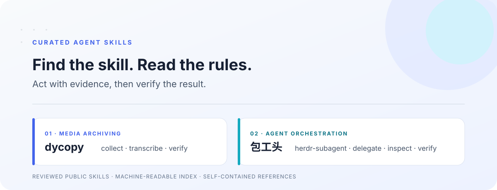

<picture>
  <source media="(prefers-color-scheme: dark)" srcset="assets/banner-dark.svg">
  
</picture>

  <b>主推</b> skill 集合 → <b>主力</b> easy-unlocker、yolo-bot → <b>工具</b> hy2-proxy-setup → <b>自用</b> kindle-gadget

<table>
  <tr>
    <td colspan="2" valign="top">
      <picture>
        <source media="(prefers-color-scheme: dark)" srcset="assets/skills-dark.svg">
        
      </picture>
        
      <b>01 · <a href="https://github.com/cyancity/curated-agent-skills">curated-agent-skills</a></b> SKILL.md · JSON · MIT 
      <b>主推</b> · 找“包工头”skill 就点这里：<a href="https://github.com/cyancity/curated-agent-skills/tree/main/skills/herdr-subagent"><code>herdr-subagent</code></a>  
      <table>
        <tr><td valign="top" width="72"><b>强项</b></td><td>每个 skill 人工审阅、脱敏后才公开，<code>catalog.json</code> 让 agent 自己按任务匹配；包工头让一个 agent 派活给其他 CLI agent，并逐个验收交付物。</td></tr>
        <tr><td valign="top"><b>局限</b></td><td>目前只有 2 个 skill；包工头要先装 Herdr CLI。</td></tr>
        <tr><td valign="top"><b>入口</b></td><td><a href="https://github.com/cyancity/curated-agent-skills/tree/main/skills/herdr-subagent">包工头</a> · <a href="https://github.com/cyancity/curated-agent-skills">全部 skill</a></td></tr>
      </table>
    </td>
  </tr>
  <tr>
    <td width="50%" valign="top">
      <picture>
        <source media="(prefers-color-scheme: dark)" srcset="assets/easy-unlocker-dark.png">
        
      </picture>
      <b>02 · <a href="https://github.com/cyancity/easy-unlocker">easy-unlocker</a></b> Kotlin · Swift · Go <b>主力</b> 
       
        
      Agent 要密钥时，明文不进对话、日志和磁盘；指纹在另一台设备上批准，值端到端加密直达进程。  
      <table>
        <tr><td valign="top" width="72"><b>强项</b></td><td>审批不在请求方机器上，无屏服务器和 CI 也能用；有正式 Release 和现成 skill。</td></tr>
        <tr><td valign="top"><b>局限</b></td><td>桌面端只有 Windows 端到端测过，macOS 未测且不在 Releases；不是密码管理器，不做浏览器自动填充。</td></tr>
        <tr><td valign="top"><b>入口</b></td><td><a href="https://github.com/cyancity/easy-unlocker/releases/latest">下载</a> · <a href="https://easy-unlocker.pages.dev/">站点</a> · <a href="https://github.com/cyancity/easy-unlocker/blob/main/docs/AGENTS-SETUP.md">Agent 手册</a></td></tr>
      </table>
    </td>
    <td width="50%" valign="top">
      <picture>
        <source media="(prefers-color-scheme: dark)" srcset="assets/yolo-bot-dark.png">
        
      </picture>
      <b>03 · <a href="https://github.com/cyancity/yolo-bot">yolo-bot</a></b> TypeScript · React <b>主力</b> 
       
        
      DeepSeek Harness 里的数字员工团队：只跟负责人说需求，它拆解、派工、汇总。  
      <table>
        <tr><td valign="top" width="72"><b>强项</b></td><td>每个员工有自己的模型、skill 和记忆，换任务不用重新交代；成果落成文件，有版本能定稿。</td></tr>
        <tr><td valign="top"><b>局限</b></td><td>绑定 DSH 0.2.1-rc.2，自身还在 pre-release；偶尔问一两句的场景用不上。</td></tr>
        <tr><td valign="top"><b>入口</b></td><td><a href="https://github.com/cyancity/yolo-bot/releases">下载</a> · <a href="https://github.com/cyancity/yolo-bot#快速开始">快速开始</a></td></tr>
      </table>
    </td>
  </tr>
  <tr>
    <td width="50%" valign="top">
      <picture>
        <source media="(prefers-color-scheme: dark)" srcset="assets/hy2-proxy-setup-dark.svg">
        
      </picture>
        
      <b>04 · <a href="https://github.com/cyancity/hy2-proxy-setup">hy2-proxy-setup</a></b> Shell · PowerShell · MIT <b>工具</b>  
      <table>
        <tr><td valign="top" width="72"><b>强项</b></td><td>一条命令装完服务端：架构识别、自签证书、BBR、防火墙；客户端带 WebRTC/IPv6/DNS 防泄露规则。</td></tr>
        <tr><td valign="top"><b>局限</b></td><td>需要一台自己的 Linux VPS；没有发布物和界面，纯脚本；可用性要按当地网络自测。</td></tr>
        <tr><td valign="top"><b>入口</b></td><td><a href="https://github.com/cyancity/hy2-proxy-setup">部署指南</a></td></tr>
      </table>
    </td>
    <td width="50%" valign="top">
      <b>自用与配套</b> · 优先级最低，不占主推位  
      <b><a href="https://github.com/cyancity/kindle-gadget">kindle-gadget</a></b> Python · Shell · MIT 
      把越狱 Kindle 当 agent 推送的墨水屏看板，一条命令推 HTML 或 PNG。 
      前提：先越狱；只在 Kindle Oasis 3 + 5.18.2 + Windows 上实测过。  
      <b><a href="https://github.com/cyancity/easy-unlocker-site">easy-unlocker-site</a></b> JavaScript 
      easy-unlocker 的官网。  
      <b><a href="https://github.com/cyancity/dycopy-public">dycopy-public</a></b> Python 
      dycopy skill 背后的源码，处理你有权访问的抖音内容。
    </td>
  </tr>
</table>

Docs an agent can run end to end · verified and unverified stated plainly · secrets never in the chat

